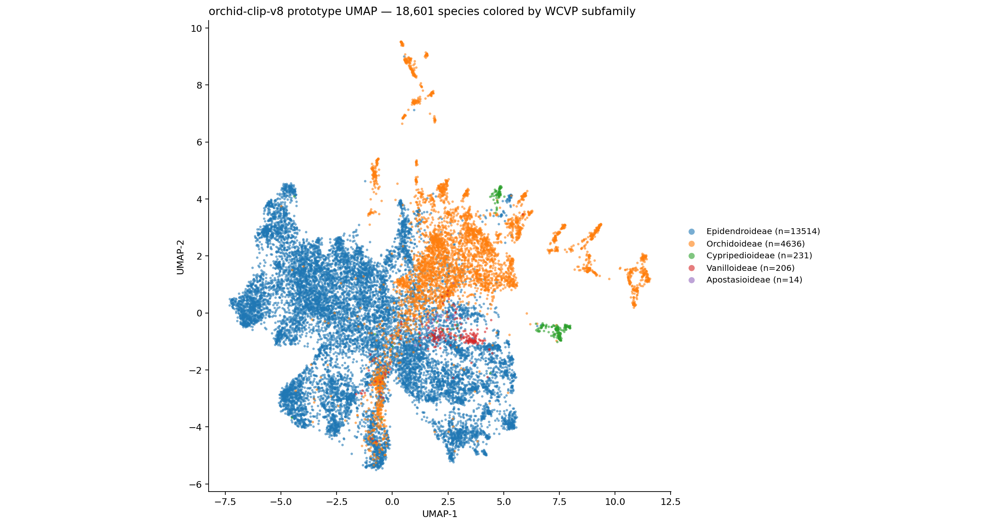

# orchid-clip

[](LICENSE)
[](https://huggingface.co/musharna/orchid-clip-v8)
[](https://huggingface.co/spaces/musharna/orchid-genus-id)

`orchid-clip-v8` is [BioCLIP 2](https://huggingface.co/imageomics/bioclip-2) (ViT-L/14) fine-tuned on orchid (Orchidaceae) photographs, with a sampler that up-weights rare species. This repository holds the inference code, the evaluation and calibration scripts, and the figure generators. The weights are on the Hugging Face Hub.

<p align="center">
  
</p>

Orchid image data are highly imbalanced: a few cultivated genera account for most public images, while many species have fewer than 30 labeled images in the public sources used here.

- Model: [musharna/orchid-clip-v8](https://huggingface.co/musharna/orchid-clip-v8) (MIT), 768-d image and text embeddings
- Demo: [musharna/orchid-genus-id](https://huggingface.co/spaces/musharna/orchid-genus-id) (upload a photo, get a genus, plus a species when the margin is large enough)
- Project page: [musharna.github.io/projects/OrchidCLIP](https://musharna.github.io/projects/OrchidCLIP/)

## Training data

The model was trained on 1.14M images across 5,124 species (at least 3 images per species, after WCVP synonym merging and a cosine-similarity quality filter), using an inverse-square-root class-frequency sampler.

The photos come from iNaturalist (research-grade), OrchidRoots, Tree of Life / EOL, IOSPE, Kew POWO, the Atlas of Living Australia, Flickr, Wikimedia Commons and the Smithsonian. They are not included in this repository or redistributed, and each keeps its owner's license: roughly 70% CC BY-NC, 13% CC BY or BY-SA, 8% all rights reserved, 8% with no stated license and 2% CC0 (measured on the 1.48M-photo candidate pool before quality filtering). The MIT license below covers the code and weights only. Photographers or site owners who want their photos left out of future training can [open an issue](https://github.com/musharna/orchid-clip/issues).

## Results

**Closed-set benchmark.** Each holdout image is ranked (image to text) against the 547 species present in the holdout. The holdout is the first 4,000 images of a 2% hash-partitioned bucket (`md5(source_id)`). It is not stratified or class-balanced, so it keeps the imbalance of the source data.

| model          | top-1 (per image) | top-1 (per genus) | top-5 | genus top-1 |
| -------------- | ----------------- | ----------------- | ----- | ----------- |
| BioCLIP 2      | 0.873             | 0.768             | 0.978 | 0.992       |
| orchid-clip-v8 | 0.911             | 0.844             | 0.986 | 0.991       |

Both columns come from the same run. The per-image gain is +3.8 percentage points (pp), and the per-genus gain is +7.6 pp. The two differ because _Ophrys_ makes up 2,754 of the 4,000 images and gains the least (+2.8 pp), so it dominates the per-image mean but counts once in the per-genus mean. The per-genus column averages over the 14 genera with at least 20 holdout images (3,937 of 4,000 images).

The gains are uneven. The largest are in genera with few holdout images (for example _Lepanthes_ +27.5 pp on 40 images, _Stelis_ +24.0 pp on 25 images), so they are estimated on small samples. Three genera get worse: _Cymbidium_ (−6.0 pp), _Laelia_ (−4.2 pp) and _Encyclia_ (−1.0 pp). Genus accuracy is unchanged (0.992 vs 0.991).

## How the demo decides

The Space embeds a photo with two models, orchid-clip-v8 and [orchid-clip-v9cw05](https://huggingface.co/musharna/orchid-clip-v9cw05), and averages their scores. It scores each of 25,342 species against three kinds of reference:

- an image centroid, the average of up to 256 of the species' reference photos;
- extra centroids: for 105 species with a known color form, one built from photos of that form, for 2,731 species, one built from photos that show no flower (leaves, buds, seed pods), and for 82 species otherwise known only from a herbarium sheet or drawing, one built from photos of the living plant. The closest of a species' centroids counts;
- the species' closest single reference photo, out of 553,991 kept in compressed form (435,957 of flowers, 117,503 that show no flower, and 531 of living plants, added for 170 species that had only a herbarium sheet or drawing).

A species' score is the mean of its centroid score and its closest-photo score. The Space shows the top species only if it beats the runner-up by at least a threshold τ and beats the best species of every other genus by at least 0.0369; otherwise it shows only the genus and lists the candidates.

`orchid_clip/references.py` holds this scoring and the loaders for the two extra files; `scripts/build_photo_rows.py` and `scripts/build_form_refs.py` build them, and `scripts/append_photo_rows.py` adds photos to an existing file without changing the rows already in it. Both files must be rebuilt whenever the centroids are. The loaders refuse a file built for another checkpoint or species list, so a stale file stops the demo at startup. The centroid file and these two are too large for the Space's own storage, so they are kept in [musharna/orchid-genus-id-references](https://huggingface.co/datasets/musharna/orchid-genus-id-references). The Space's `assets/model.json` names one commit of that repo and a sha256 for each file, and `resolve_assets` downloads them at startup and refuses any file whose hash differs. (`app.py` and `infer.py` here are an earlier version that ranks against text embeddings of 18,858 species names.)

The deployed τ = 0.0118 was chosen with `risk_coverage_curve` and `select_tau` in `eval/calibrate_genus_abstain.py`, on 5,050 photos of 2,494 species held out of training and of the references. Of the 8,837 held-out photos, 3,773 share an iNaturalist observation with a reference photo and were left out, because a near-copy among the references makes them score too high. Another 14 are of species the demo has no entry for. τ was tuned and scored on the same photos, so the precision and coverage figures are in-sample.

| metric (25,342 candidate species)                 | value                |
| ------------------------------------------------- | -------------------- |
| species top-1, no abstain (held-out, n = 5,050)   | 0.78                 |
| genus top-1 (same set)                            | 0.93                 |
| shown-species precision with abstain (in-sample)  | 0.94 at 67% coverage |
| genus top-1 on species with no centroid (n = 243) | 0.65                 |

The second condition, the lead over other genera, was added on 2026-11-10 to cut wrong names on species the demo has no entry for. When a photo is of such a species, the runners-up tend to come from several genera. The threshold was set on half of the species (split by a hash of the species name) and tested once on the other half. There, on 121 photos of species with no entry, the demo named a species, always wrongly, for 23 instead of 45. On 2,474 photos of species it does know, it kept 1,538 of 1,611 right names and dropped 85 of 184 wrong ones, so named species were right 94% of the time instead of 90%, and a species was named for 66% of photos instead of 73%. With τ alone, the figures on all 5,050 photos were 0.90 at 73% coverage.

The non-flower references were added on 2026-11-10. On 3,633 held-out photos that show no flower, scored once after the method and τ were fixed, species top-1 went from 0.61 to 0.79 and genus top-1 from 0.82 to 0.96. Those photos come from the same collection as the references (photos of the same observation were kept apart), so the gain on entirely new photos is probably smaller.

On 1,885 iNaturalist photos of flowers posted from October 31 to November 10, 2026, species top-1 is 0.83, and shown species are right 93% of the time at 75% coverage. These photos were first scored once for the version without non-flower references (0.82, 93% at 73%), so this is their second use.

Before 2026-10-20 the demo's gallery left out about 5,200 species in the tribes Vandeae and Cymbidieae (_Phalaenopsis_, _Vanda_, _Oncidium_, _Cymbidium_ and relatives): the centroid build filtered by subfamily and omitted the legacy name Vandoideae. Adding them raised held-out genus top-1 from 0.80 to 0.92.

## Use it as an embedding

```bash
pip install open_clip_torch huggingface_hub torch pillow
```

```python
import torch, open_clip
from huggingface_hub import snapshot_download
from PIL import Image

ckpt = snapshot_download(
    "musharna/orchid-clip-v8"
)  # model_config.json + open_clip_pytorch_model.bin
model, _, preprocess = open_clip.create_model_and_transforms(
    "ViT-L-14", pretrained=None
)
state = torch.load(
    f"{ckpt}/open_clip_pytorch_model.bin", map_location="cpu", weights_only=False
)
model.load_state_dict(state["state_dict"])
model.eval()  # weights live under state["state_dict"]

img = preprocess(Image.open("orchid.jpg").convert("RGB")).unsqueeze(0)
with torch.no_grad():
    feat = model.encode_image(img)
feat = feat / feat.norm(dim=-1, keepdim=True)  # 768-d, L2-normalized
```

The feature can be ranked against species text embeddings or image centroids, or used for retrieval.

## Repository contents

| path                        | contents                                                                                                                                                               |
| --------------------------- | ---------------------------------------------------------------------------------------------------------------------------------------------------------------------- |
| `orchid_clip/`              | inference package: embedder (`embedder.py`), species abstain (`abstain.py`), genus rollup (`genus.py`)                                                                 |
| `infer.py`, `app.py`        | scoring core and Gradio UI for the earlier text-embedding version of the demo                                                                                          |
| `orchid_clip/references.py` | the live demo's extra references: color-form centroids and photo-level scoring (build, load, score)                                                                    |
| `scripts/`                  | `build_photo_rows.py`, `append_photo_rows.py` and `build_form_refs.py` (build the two reference files), `smoke.py` (CI check, with a round trip of the reference code) |
| `eval/`                     | `eval_bioclip_vs_orchid_clip.py` (closed-set and per-genus results), `audit_v7_confusions.py` (confusion pairs), `calibrate_genus_abstain.py` (τ)                      |
| `viz/`                      | Plotly scripts for the project-page figures (risk-coverage, per-genus change, class frequency, prototype UMAP)                                                         |

The `eval/` scripts and `app.py` need an image catalog and embedding assets (`assets/v8_text_embeddings.npz`, `genus_abstain.json`, `taxonomy.json`). These come from the training pipeline, which is not included here, so the scripts show the method but cannot be run end to end from this repository alone. The model weights on the Hub can be used without them.

## Limitations

- All results above are on an iNaturalist-dominated holdout. On other field-photo sources, top-1 drops by 0.10 to 0.11. On herbarium specimens and botanical illustrations (IOSPE, POWO), top-1 falls to 0.14 to 0.19 and genus accuracy to about 0.55. Use the model on field photographs.
- Within-genus species identification is the weak point. Several attempts to improve within-genus species accuracy on the model side did not help; adding photos for rare species did.
- Some sister species (e.g. _Cattleya labiata_ / _trianae_ / _warneri_) are hard to tell apart from photographs. This is a research tool, not a substitute for expert or vouchered identification.

## Citation

```bibtex
@software{orchid_clip_2026,
  author = {Arnold, Jaret},
  title  = {orchid-clip: a BioCLIP 2 fine-tune for orchid identification},
  year   = {2026},
  url    = {https://github.com/musharna/orchid-clip},
  note   = {Model: huggingface.co/musharna/orchid-clip-v8}
}
```

## License

MIT, for code and model. Built on [BioCLIP 2](https://huggingface.co/imageomics/bioclip-2) (Imageomics).
